

# PDM — Website UI/UX Design

**A bilingual digital agency website experience**

UI/UX Design · Arabic & English · Light & Dark Themes

**Designer:** Ahmed Rami  |  **Project:** PDM  |  **Role:** UI/UX Designer

---

## 01 · Project Overview

PDM is a digital services agency website presenting web development, UI/UX design, digital marketing, and brand identity services. This case study documents the **website interface and user-experience design** through selected screen captures.

**My contribution:** UI/UX design. This portfolio does not claim responsibility for front-end development or implementation.

## 02 · Design Direction

The interface combines a deep navy foundation, vivid electric-blue accents, spacious light surfaces, and illustrated service cards. The design uses a prominent introductory section, clear calls to action, and consistent navigation to guide visitors through the agency's offerings.

### Key interface considerations

- **Bilingual layouts:** Arabic right-to-left and English left-to-right presentations.
- **Theme flexibility:** light and dark appearances with consistent component styling.
- **Navigation:** clear access to Home, Services, Portfolio, About, and Contact.
- **Content hierarchy:** prominent headlines, supporting descriptions, and action buttons.
- **Service discovery:** categorized cards and portfolio filtering controls shown in the designs.

## 03 · Selected Screens

### Homepage · English / Light
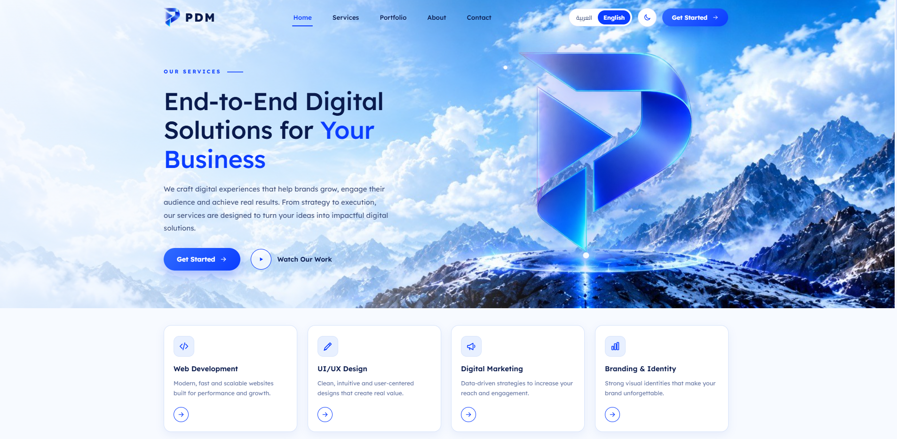

### Homepage · Arabic / Light
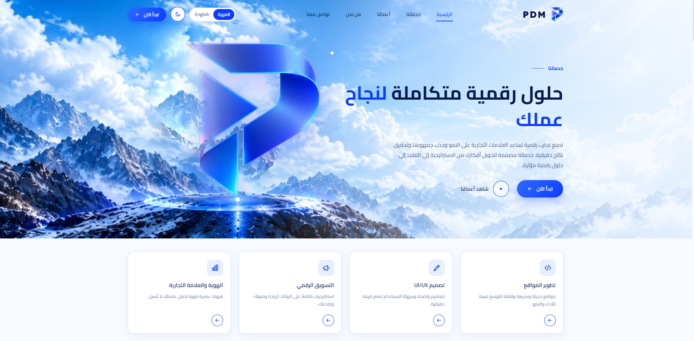

### Homepage · English / Dark
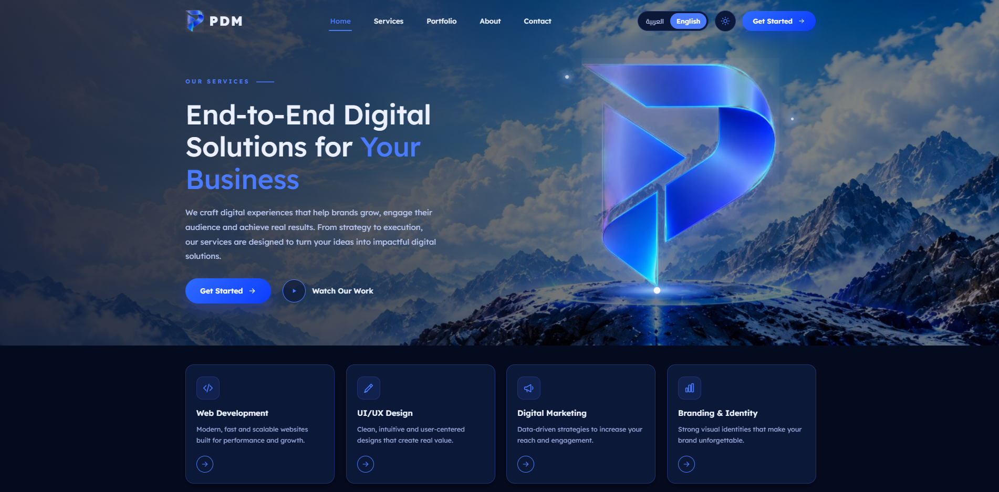

### Services · Arabic / Dark
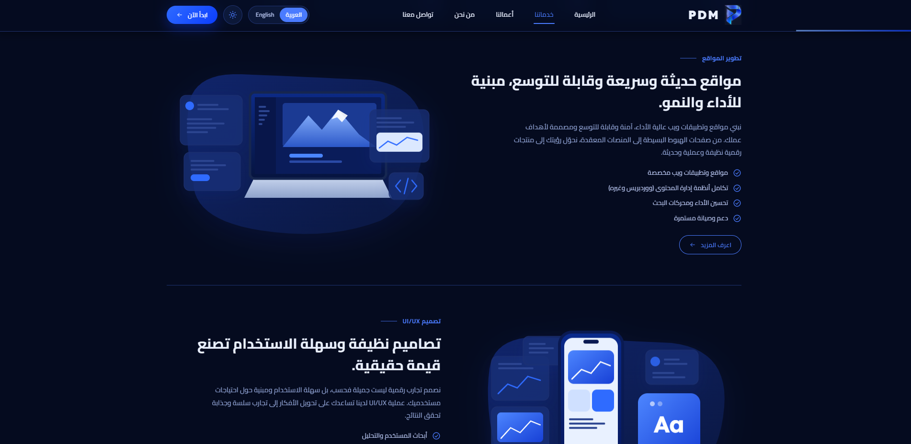

### Services · Arabic / Light
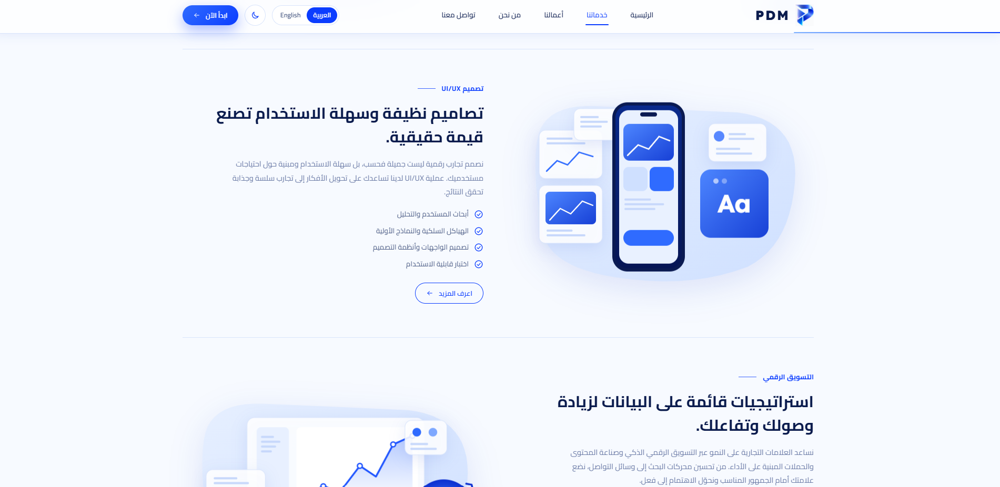

### Portfolio · Arabic / Light
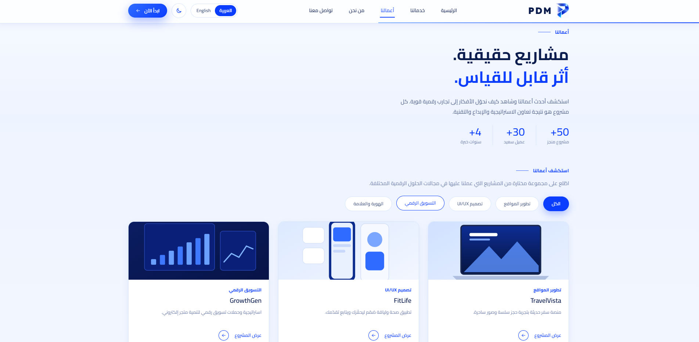

### Portfolio · English / Dark
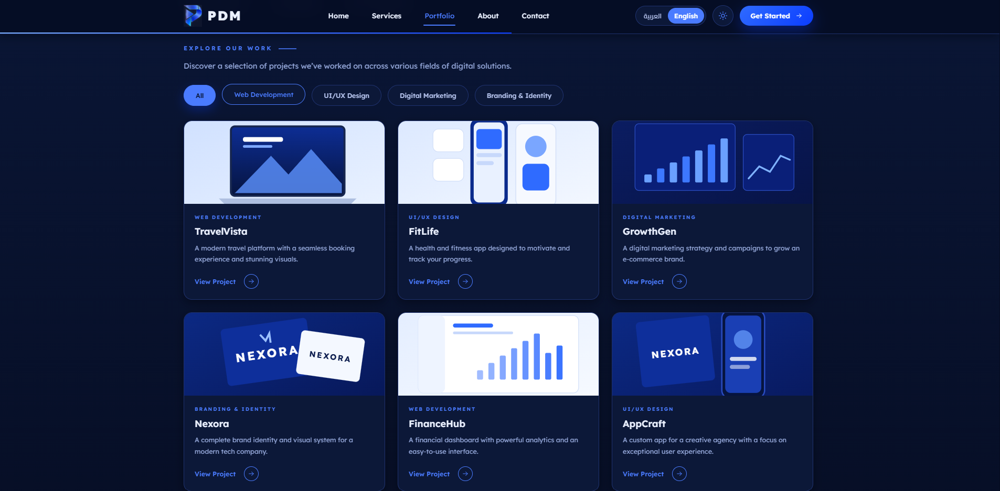

### About · English / Dark
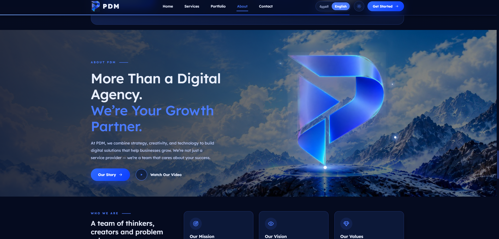

### About · English / Light
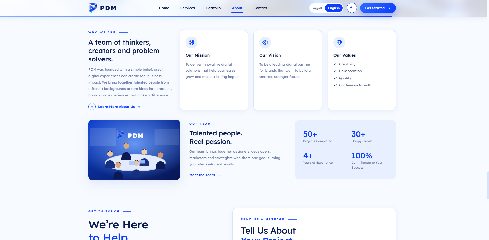

### Contact & Footer · Light
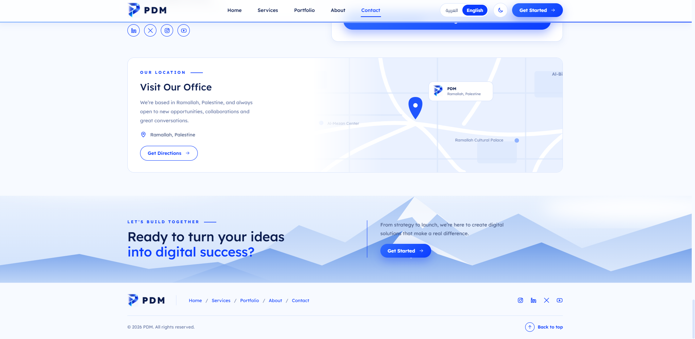

## 04 · Additional Interface Details

### Digital Marketing Section
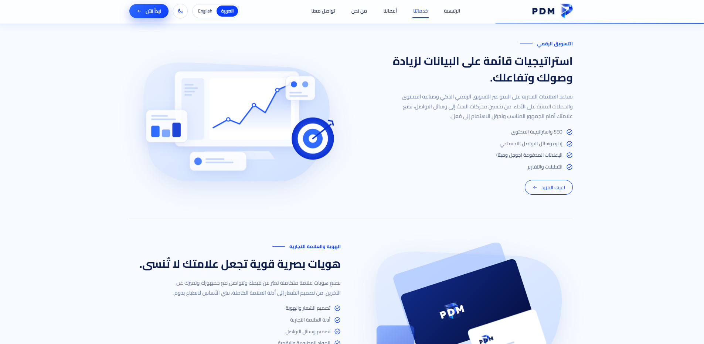

### Branding Section
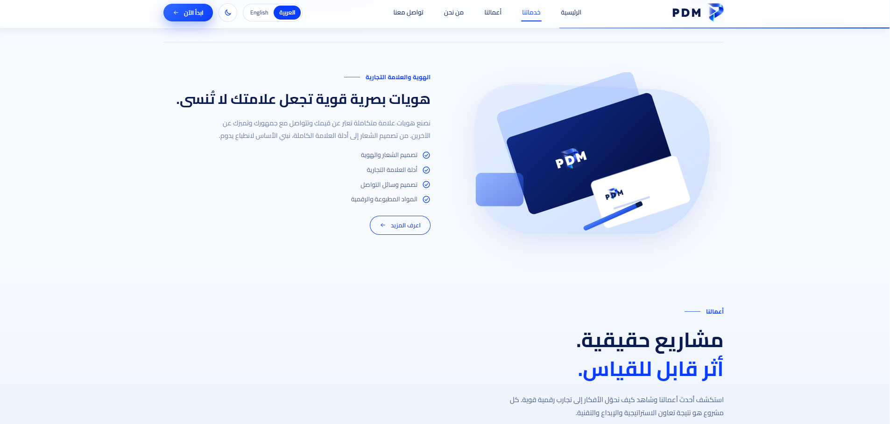

## 05 · Design Notes

The visual system emphasizes strong headline contrast, repeatable card components, recognizable blue-accent buttons, and consistent layout patterns across the site's sections. Arabic and English views demonstrate adaptations in alignment and reading direction, while light and dark views illustrate alternate visual treatments.

These notes describe **visible design choices**. User research, usability testing, conversion improvements, and business impact are not claimed without supporting evidence.

## 06 · Credits & Scope

- **Company / Project:** PDM
- **UI/UX Designer:** Ahmed Rami
- **Scope documented:** website interface and experience design
- **Materials:** selected project screenshots, included for portfolio documentation subject to PDM's permission

> This repository is a design case study, not the website source code. All PDM trademarks, content, and related assets remain the property of their respective owners.
